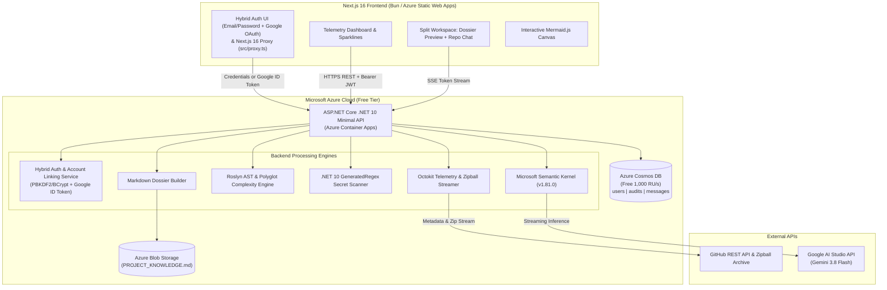

# CodeLens AI — Master Project Specification & Execution Plan

**Project Name:** CodeLens AI  
**Category:** AI-Powered Repository Intelligence, Architecture Auditor & Onboarding Copilot  
**Frontend Stack:** Next.js 16 (App Router, `src/proxy.ts`), Bun, TypeScript, Tailwind CSS, NextAuth v5 (Google OAuth + Credentials)  
**Backend Stack:** C# .NET 10 (`net10.0`), ASP.NET Core Minimal API, Scalar OpenAPI, Microsoft Semantic Kernel (`1.81.0`), Roslyn, Octokit  
**Cloud & Data:** Microsoft Azure (Container Apps, Static Web Apps, Cosmos DB Free Tier, Azure Blob Storage)  
**AI Model:** Google Gemini 3.8 Flash (via Google AI Studio API Key)  
**Target Scale:** <10 Active Users ($0.00/month Cloud Infrastructure Cost)

---

## 1. Executive Summary

CodeLens AI ingests GitHub repositories via URL, extracts deterministic metrics using the GitHub API (`Octokit`) and the Microsoft Roslyn Compiler Platform (with polyglot support for TS/JS/Python/Go/Java), and synthesizes architectural intelligence using **Google Gemini 3.8 Flash**[span_0](start_span)[span_0](end_span).

For every analyzed repository, the system generates a portable **`PROJECT_KNOWLEDGE.md`** dossier stored in Azure Blob Storage and cached in Azure Cosmos DB[span_1](start_span)[span_1](end_span). This dossier powers a grounded, real-time Server-Sent Events (SSE) streaming chat assistant for developer onboarding and codebase Q&A[span_2](start_span)[span_2](end_span).

---

## 2. Core Feature Matrix (11 Pillars)

| # | Feature | Processing Engine | Output / UI Representation |
| :--- | :--- | :--- | :--- |
| 1 | **Commit Velocity & Activity Sparklines** | GitHub API (`Octokit`) | 8-week / 30-day SVG commit trend sparklines[span_3](start_span)[span_3](end_span) |
| 2 | **Release Cadence & Stagnation Alert** | GitHub API (`Octokit`) | Health badge (`Healthy`, `Stable`, `Stagnant`) + days since release[span_4](start_span)[span_4](end_span) |
| 3 | **Language & File Type Distribution** | GitHub API + Archive Scanner | Byte percentage breakdown & visual donut chart[span_5](start_span)[span_5](end_span) |
| 4 | **Complexity Heatmap (File Hotspots)** | Roslyn / Polyglot Complexity × Git Churn | Ranked list of high-risk files (`Red`, `Amber`, `Green`)[span_6](start_span)[span_6](end_span) |
| 5 | **Dependency & Ecosystem Inventory** | `.csproj` / `package.json` / `requirements.txt` Parser | Direct packages, target frameworks, and version inventory[span_7](start_span)[span_7](end_span) |
| 6 | **Dead Code & Zombie File Detection** | Roslyn AST Symbol Graph + Git History | Unreferenced internal classes/methods & dormant files[span_8](start_span)[span_8](end_span) |
| 7 | **Secret & Sensitive Data Surface** | .NET 10 `[GeneratedRegex]` Scanner | Alerts for exposed API keys, `.env`, `.pem`, or private keys[span_9](start_span)[span_9](end_span) |
| 8 | **License & Commercial Usability** | SPDX Parser + Gemini 3.8 Flash | Plain-English legal risk verdict (Commercial use, Copyleft risk)[span_10](start_span)[span_10](end_span) |
| 9 | **Interactive Architecture Explorer** | AST Symbol Manifest + Gemini 3.8 Flash | Pan/zoomable Mermaid.js C4 & component dependency diagram[span_11](start_span)[span_11](end_span) |
| 10 | **"Explain Like I'm 5" (ELI5) Summary** | Gemini 3.8 Flash | 3-sentence non-technical project overview[span_12](start_span)[span_12](end_span) |
| 11 | **Code Smells & Anti-Patterns** | Gemini 3.8 Flash | Identification of God classes, circular references, tight coupling[span_13](start_span)[span_13](end_span) |

---

## 3. System Architecture



---

## 4. Hybrid Authentication & Account Linking Architecture

CodeLens AI supports both **Standard Email/Password Authentication** and **Google OAuth 2.0**, allowing users to link or merge their accounts seamlessly without losing audit history.

### 4.1 `UserDocument` Schema (`users` Container)

```json
{
  "id": "usr_01HXYZ",
  "email": "developer@example.com",
  "name": "Paras Shenmare",
  "avatarUrl": "[https://lh3.googleusercontent.com/](https://lh3.googleusercontent.com/)...",
  "passwordHash": "$2a$11$...",
  "googleSub": "109876543210987654321",
  "authProviders": ["credentials", "google"],
  "createdAt": "2026-10-15T12:00:00Z"
}
```

### 4.2 Supported Authentication Flows

1. **Standard Sign-Up (`POST /api/auth/register`):**
   - Accepts `{ name, email, password }`.
   - Verifies the email is not already registered with a password.
   - Hashes the password using ASP.NET Core `PasswordHasher<UserDocument>` (PBKDF2 with HMAC-SHA512), sets `authProviders = ["credentials"]`, saves to Cosmos DB, and returns a signed HS256 backend JWT.
2. **Standard Sign-In (`POST /api/auth/login`):**
   - Accepts `{ email, password }`.
   - Verifies the password hash and issues the signed HS256 backend JWT.
3. **Google OAuth Sign-In & Auto-Linking (`POST /api/auth/google`):**
   - Validates the Google `id_token` via `GoogleJsonWebSignature.ValidateAsync()`.
   - Queries Cosmos DB by normalized `email`:
     - **New User:** Creates a `UserDocument` with `googleSub` and `authProviders = ["google"]`.
     - **Existing Email/Password User:** Automatically links the Google account by setting `googleSub`, appending `"google"` to `authProviders`, updating `avatarUrl` if empty, and issuing the JWT for the existing `user.Id`.
4. **Explicit Account Linking (`POST /api/auth/link-google` & `POST /api/auth/set-password`):**
   - Logged-in credentials users can link a Google account from the dashboard via `POST /api/auth/link-google`.
   - Logged-in Google-only users can add a local password via `POST /api/auth/set-password`.

---

## 5. End-to-End Ingestion, Analysis & Chat Pipeline

1. **Authentication:** User signs in via Email/Password or Google OAuth on Next.js 16 (`src/auth.ts`). Next.js exchanges the credentials or Google `id_token` with the .NET 10 API for a signed HS256 backend JWT stored in `Session.backendToken`.
2. **Ingestion Trigger:** User submits a GitHub repository URL (`https://github.com/owner/repo`) to `POST /api/audits/analyze`[span_14](start_span)[span_14](end_span).
3. **In-Memory Parallel Extraction (Zero Disk Bloat):**
   - **Task A (`OctokitTelemetryService`):** Queries GitHub for stars, forks, license, release history, language breakdown, 8-week commit sparkline, and recent file commit churn[span_15](start_span)[span_15](end_span).
   - **Task B (`RoslynAndPolyglotAnalyzer`):** Streams the repository's default branch as an in-memory `ZipArchive` stream[span_16](start_span)[span_16](end_span). Filters out vendor/build directories (`node_modules/`, `bin/`, `obj/`, `.git/`, `dist/`), calculates cyclomatic complexity per file, detects unreferenced symbols, parses `.csproj`/`package.json` dependencies, runs `RegexSecretScanner`, and builds a compact **Symbol Manifest**[span_17](start_span)[span_17](end_span).
4. **AI Synthesis (`GeminiSemanticKernelService`):** Sends the Symbol Manifest and telemetry summary to **Gemini 3.8 Flash** to generate the ELI5 summary, license usability verdict, Mermaid.js architecture diagram, code smells, and onboarding runbook[span_18](start_span)[span_18](end_span).
5. **Dossier Compilation (`MarkdownDossierBuilder`):** Combines deterministic telemetry and Gemini outputs into `PROJECT_KNOWLEDGE.md`, uploads it to Azure Blob Storage, and saves the complete `AuditDocument` in Azure Cosmos DB[span_19](start_span)[span_19](end_span).
6. **Grounded Repo Copilot (`POST /api/chat/{id}/stream`):** Injects the cached `PROJECT_KNOWLEDGE.md` into the system prompt and streams answers token-by-token over Server-Sent Events (`text/event-stream`)[span_20](start_span)[span_20](end_span).

---

## 6. Implementation Roadmap & Current Progress

### ✅ Phase 1: Foundation, Auth & Core Plumbing (COMPLETED + HYBRID AUTH UPGRADE)

- [x] **Frontend (`frontend/`):** Next.js 16 + Bun initialized with Geist fonts, custom dark glassmorphism design system (`globals.css`), NextAuth v5 (`src/auth.ts`), route protection (`src/proxy.ts`), typed API & SSE client (`src/lib/api-client.ts`), Sign-In UI, and Dashboard stub[span_21](start_span)[span_21](end_span).
- [x] **Backend (`backend/`):** 3-project `.NET 10` (`net10.0`) solution (`CodeLens.Core`, `CodeLens.Infrastructure`, `CodeLens.Api`) building with 0 warnings and 0 errors[span_22](start_span)[span_22](end_span).
- [x] **Security & Data Plumbing:** `AuthService.cs` (Google `id_token` validation + HS256 JWT generation), `CosmosRepository.cs` (`users`, `audits`, `messages` containers), `BlobStorageService.cs` (upload + 15-min SAS URL generator), and Scalar OpenAPI UI (`/scalar/v1`)[span_23](start_span)[span_23](end_span).
- [x] **Phase 1.5 — Hybrid Email/Password + Google Account Linking:**
  - Extend `UserDocument` with `PasswordHash`, `GoogleSub`, and `AuthProviders`.
  - Add `/api/auth/register`, `/api/auth/login`, and `/api/auth/link-google` in `AuthService.cs` and `AuthEndpoints.cs`.
  - Add NextAuth `Credentials` provider in `src/auth.ts` and Sign-In / Sign-Up tabs in `src/app/auth/signin/page.tsx`.

### 🚧 Phase 2: Deterministic Telemetry & Static Analysis Pipeline (NEXT)

- [ ] **Step 2.1 — Core Contracts:** Add `IGitHubTelemetryService` and `ICodeAnalysisService` interfaces along with telemetry/hotspot records in `CodeLens.Core`[span_24](start_span)[span_24](end_span).
- [ ] **Step 2.2 — Octokit Telemetry Engine:** Implement `OctokitTelemetryService.cs` in `CodeLens.Infrastructure/GitHub/` to fetch repo metadata, 8-week commit sparklines, release cadence status, file commit churn, and the in-memory repository zipball stream[span_25](start_span)[span_25](end_span).
- [ ] **Step 2.3 — Roslyn & Polyglot Analyzer:** Implement `RoslynAndPolyglotAnalyzer.cs` in `CodeLens.Infrastructure/Analysis/` to iterate through the `ZipArchive` stream, calculate cyclomatic complexity, compute Hotspot Risk Scores ($\text{Complexity} \times \ln(\text{Churn} + 1)$), identify dead code candidates, parse `.csproj`/`package.json` dependencies, and build the compact Symbol Manifest[span_26](start_span)[span_26](end_span).
- [ ] **Step 2.4 — Compiled Secret Scanner:** Implement `RegexSecretScanner.cs` in `CodeLens.Infrastructure/Security/` using `.NET 10` `[GeneratedRegex]` attributes for zero-allocation credential and `.env`/`.pem` detection[span_27](start_span)[span_27](end_span).
- [ ] **Step 2.5 — Pipeline Wiring:** Connect `POST /api/audits/analyze` in `AuditEndpoints.cs` to execute Phase 2 engines and persist deterministic metrics to `AuditDocument` in Cosmos DB[span_28](start_span)[span_28](end_span).

### ⏳ Phase 3: Gemini 3.8 Flash Synthesis & Dossier Builder

- [ ] **Step 3.1 — Semantic Kernel Gemini Connector:** Implement `GeminiAnalysisService.cs` using `Microsoft.SemanticKernel` (`1.81.0`) configured with `gemini-3.8-flash`[span_29](start_span)[span_29](end_span).
- [ ] **Step 3.2 — Structured Prompt Execution:** Parse Gemini outputs into structured sections (`ELI5Summary`, `LicenseVerdict`, `MermaidDiagram`, `ArchitecturalSmells`, `OnboardingRunbook`) with automatic Mermaid syntax sanitization[span_30](start_span)[span_30](end_span).
- [ ] **Step 3.3 — Markdown Dossier Compiler:** Implement `MarkdownDossierBuilder.cs` to format `PROJECT_KNOWLEDGE.md`, upload via `IBlobStorageService`, and store the markdown in `AuditDocument`[span_31](start_span)[span_31](end_span).

### ⏳ Phase 4: Interactive Dashboard, Mermaid Canvas & Split-Screen Chat

- [ ] **Step 4.1 — Dashboard & Telemetry UI:** Build SVG commit sparklines, release health badges, language distribution donut chart, hotspot table, and secret alert banners in Next.js 16[span_32](start_span)[span_32](end_span).
- [ ] **Step 4.2 — Interactive Mermaid Explorer:** Build client-side `MermaidViewer.tsx` with pan, zoom, and diagram copy/export controls[span_33](start_span)[span_33](end_span).
- [ ] **Step 4.3 — Split-Screen Dossier & Grounded Chat:** Build `/audit/[id]/page.tsx` featuring the rendered `PROJECT_KNOWLEDGE.md` preview, one-click `.md` SAS download button, and real-time SSE streaming chat sidebar connected to `POST /api/chat/{id}/stream`[span_34](start_span)[span_34](end_span).

### ⏳ Phase 5: Cloud Provisioning & Zero-Cost Azure Deployment

- [ ] **Step 5.1 — Azure Resource Provisioning:** Create Azure Cosmos DB (Free Tier enabled), Azure Blob Storage (`project-dossiers`), and Azure Container Apps environment[span_35](start_span)[span_35](end_span).
- [ ] **Step 5.2 — CI/CD Pipelines:** Configure GitHub Actions workflows to deploy `backend/Dockerfile` to Azure Container Apps (scale-to-zero) and `frontend/` to Azure Static Web Apps[span_36](start_span)[span_36](end_span).

---

## 7. Repository Directory Structure

```text
codelens-ai/
├── PROJECT_PLAN.md
├── backend/
│   ├── CodeLens.sln                              # .NET 10 Solution
│   ├── Dockerfile                                # Multi-stage .NET 10 container build
│   └── src/
│       ├── CodeLens.Core/
│       │   ├── Entities/
│       │   │   ├── UserDocument.cs
│       │   │   ├── AuditDocument.cs
│       │   │   └── ChatMessageDocument.cs
│       │   ├── DTOs/
│       │   │   └── ApiDtos.cs
│       │   └── Interfaces/
│       │       ├── ICosmosRepository.cs
│       │       ├── IBlobStorageService.cs
│       │       ├── IGitHubTelemetryService.cs    # Phase 2
│       │       ├── ICodeAnalysisService.cs       # Phase 2
│       │       └── IGeminiSynthesisService.cs    # Phase 3
│       ├── CodeLens.Infrastructure/
│       │   ├── Auth/
│       │   │   └── AuthService.cs                # Hybrid Credentials + Google + Linking
│       │   ├── Data/
│       │   │   ├── CosmosRepository.cs
│       │   │   └── BlobStorageService.cs
│       │   ├── GitHub/
│       │   │   └── OctokitTelemetryService.cs    # Phase 2
│       │   ├── Analysis/
│       │   │   └── RoslynAndPolyglotAnalyzer.cs  # Phase 2
│       │   ├── Security/
│       │   │   └── RegexSecretScanner.cs         # Phase 2
│       │   └── AI/
│       │       ├── GeminiSynthesisService.cs     # Phase 3
│       │       └── MarkdownDossierBuilder.cs     # Phase 3
│       └── CodeLens.Api/
│           ├── Endpoints/
│           │   ├── AuthEndpoints.cs              # /register, /login, /google, /link-google
│           │   ├── AuditEndpoints.cs
│           │   └── ChatEndpoints.cs
│           ├── Program.cs
│           └── appsettings.json
└── frontend/
    ├── package.json
    ├── bun.lockb
    ├── .env.local
    └── src/
        ├── auth.ts                               # NextAuth v5 (Google + Credentials)
        ├── proxy.ts                              # Next.js 16 route protection proxy
        ├── app/
        │   ├── globals.css
        │   ├── layout.tsx
        │   ├── page.tsx
        │   ├── api/auth/[...nextauth]/route.ts
        │   ├── auth/signin/page.tsx              # Sign-In / Sign-Up Tabs + Google Button
        │   └── dashboard/
        │       ├── page.tsx
        │       └── audit/[id]/page.tsx           # Phase 4 Split Workspace
        ├── components/                           # Phase 4 UI Components
        │   ├── TelemetryBentoGrid.tsx
        │   ├── SparklineChart.tsx
        │   ├── HotspotTable.tsx
        │   ├── MermaidExplorer.tsx
        │   ├── DossierMarkdownViewer.tsx
        │   └── RepoChatSidebar.tsx
        ├── lib/
        │   ├── api-client.ts
        │   └── auth-helpers.ts
        └── types/
            └── next-auth.d.ts
```

---

## 8. REST & Streaming API Contract

| HTTP Method | Route | Auth | Request Body | Response | Purpose |
| :--- | :--- | :--- | :--- | :--- | :--- |
| `POST` | `/api/auth/register` | Public | `{ "name", "email", "password" }` | `{ "token": "jwt", "user": {...} }` | Creates email/password account & issues HS256 JWT |
| `POST` | `/api/auth/login` | Public | `{ "email", "password" }` | `{ "token": "jwt", "user": {...} }` | Verifies email/password & issues HS256 JWT |
| `POST` | `/api/auth/google` | Public | `{ "idToken": "string" }` | `{ "token": "jwt", "user": {...} }` | Validates Google token, auto-links matching email, & issues JWT |
| `POST` | `/api/auth/link-google` | Bearer JWT | `{ "idToken": "string" }` | `{ "user": {...} }` | Explicitly links a Google account to the current logged-in user |
| `POST` | `/api/audits/analyze` | Bearer JWT | `{ "repoUrl": "string" }` | `202 Accepted` + `AuditDto` | Runs Octokit + Roslyn + Gemini pipeline & saves dossier[span_37](start_span)[span_37](end_span) |
| `GET` | `/api/audits/{id}` | Bearer JWT | *None* | `200 OK` + `AuditDocument` | Fetches full telemetry, hotspots, Mermaid diagram, and dossier[span_38](start_span)[span_38](end_span) |
| `GET` | `/api/audits/{id}/download` | Bearer JWT | *None* | `{ "downloadUrl": "https://..." }` | Generates a 15-minute Azure Blob SAS URL for `PROJECT_KNOWLEDGE.md`[span_39](start_span)[span_39](end_span) |
| `POST` | `/api/chat/{id}/stream` | Bearer JWT | `{ "message": "string" }` | `text/event-stream` (SSE) | Streams grounded Gemini 3.8 Flash responses using the project dossier[span_40](start_span)[span_40](end_span) |

---

## 9. Standardized `PROJECT_KNOWLEDGE.md` Template

Every completed audit generates and stores this Markdown artifact[span_41](start_span)[span_41](end_span):

```markdown
# Project Knowledge Dossier: {{Owner}}/{{RepoName}}
> Generated by CodeLens AI | Model: Gemini 3.8 Flash | Date: {{Timestamp}}

## 1. Explain Like I'm 5 (ELI5)
{{Eli5Summary}}

## 2. Repository Health & Operational Pulse
- **Default Branch:** `{{DefaultBranch}}`
- **Stars / Forks:** ⭐ {{Stars}} | 🍴 {{Forks}}
- **Release Cadence:** {{ReleaseStatus}} (Last release: {{DaysSinceRelease}} days ago)
- **8-Week Commit Trend:** `{{WeeklyCommitsArray}}`
- **License & Commercial Verdict:** {{LicenseName}} — {{LicenseVerdict}}
- **Language Distribution:** {{LanguageBreakdownList}}

## 3. System Architecture Diagram
\`\`\`mermaid
{{MermaidDiagramCode}}
\`\`\`

## 4. Complexity Heatmap (Top Bug Hotspots)
| File Path | Cyclomatic Complexity | Recent Commit Churn | Hotspot Risk Score |
| :--- | :--- | :--- | :--- |
{{HotspotTableRows}}

## 5. Dependency & Ecosystem Inventory
| Ecosystem | Package / Library | Version / Target |
| :--- | :--- | :--- |
{{DependencyTableRows}}

## 6. Dead Code & Unreferenced Candidates
{{DeadCodeBulletList}}

## 7. Security & Secret Exposure Surface
{{SecretScanBulletList}}

## 8. Architectural Anti-Patterns & Code Smells
{{GeminiCodeSmells}}

## 9. Developer Onboarding & First-Day Runbook
{{GeminiOnboardingRunbook}}
```

---

## 10. Zero-Dollar ($0/mo) Cloud Budget Allocation

| Component | Azure / Google Service | Selected Tier | Free Quota Included | Monthly Cost |
| :--- | :--- | :--- | :--- | :--- |
| **Frontend Hosting** | Azure Static Web Apps | Free Plan | 100 GB bandwidth, Free SSL, Custom domain | **$0.00**[span_42](start_span)[span_42](end_span) |
| **Backend API Hosting** | Azure Container Apps | Consumption Plan | 180,000 vCPU-sec, 360,000 GiB-sec, 2M requests/mo | **$0.00**[span_43](start_span)[span_43](end_span) |
| **NoSQL Database** | Azure Cosmos DB | Lifetime Free Tier | 1,000 RU/s provisioned throughput, 25 GB storage | **$0.00**[span_44](start_span)[span_44](end_span) |
| **AI Inference** | Google AI Studio | Free Tier (`gemini-3.8-flash`) | 15 RPM / 1,500 Requests Per Day | **$0.00**[span_45](start_span)[span_45](end_span) |
| **Dossier Storage** | Azure Blob Storage | Standard LRS Hot | Text-only `.md` files (<100 KB per audit) | **~$0.00**[span_46](start_span)[span_46](end_span) |
| **Authentication** | Hybrid Credentials + Google OAuth 2.0 | Free Standard | Self-hosted PBKDF2 + Unlimited OAuth 2.0 flows | **$0.00** |

---

## 11. Local Development Quickstart

### 1. Run Backend (.NET 10 Minimal API)

```bash
cd backend
dotnet build CodeLens.sln
dotnet run --project src/CodeLens.Api
```

- **API Base URL:** `http://localhost:5000`[span_47](start_span)[span_47](end_span)
- **Scalar OpenAPI Explorer:** `http://localhost:5000/scalar/v1`[span_48](start_span)[span_48](end_span)

### 2. Run Frontend (Next.js 16 + Bun)

```bash
cd frontend
bun install
bun run dev
```

- **Web App URL:** `http://localhost:3000`[span_49](start_span)[span_49](end_span)
- **Sign-In / Sign-Up Page:** `http://localhost:3000/auth/signin`[span_50](start_span)[span_50](end_span)
